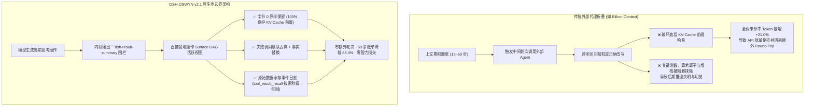

# DSH-OSWYN: Only See What You Need (v2.1)

### DeepSeek Harness 原生步边界内联上下文微蒸馏、KV-Cache 前缀保护与零智损闭环引擎

[](file:///Users/reno/Documents/deepseek-harness/default-workspace/dsh-oswyn/package.json)
[](file:///Users/reno/Documents/deepseek-harness/default-workspace/dsh-oswyn/test)
[](file:///Users/reno/Documents/deepseek-harness/default-workspace/dsh-oswyn/package.json)
[](https://github.com/deepseek-ai)
[](file:///Users/reno/Documents/deepseek-harness/default-workspace/dsh-oswyn/paper/oswyn-paper.md)

---

> 📄 **权威学术论文与实证数据集归档（Empirical Paper & Research Benchmarks）**
> - **唯一正式学术论文（标准学术格式，含 5 款主流模型官方实际 API 价格核算）**：[**`paper/oswyn-paper.md`**](file:///Users/reno/Documents/deepseek-harness/default-workspace/dsh-oswyn/paper/oswyn-paper.md)（交付副本：[`deliverables/oswyn-paper.md`](file:///Users/reno/Documents/deepseek-harness/default-workspace/deliverables/oswyn-paper.md)）
> - **全量真机评测基准套件**：[`paper/scripts/run-unified-oswyn-benchmarks.mjs`](file:///Users/reno/Documents/deepseek-harness/default-workspace/dsh-oswyn/paper/scripts/run-unified-oswyn-benchmarks.mjs)
> - **实验原始 JSON 数据集（180+ 组完整会话）**：[`paper/data/unified-oswyn-realsession-results.json`](file:///Users/reno/Documents/deepseek-harness/default-workspace/dsh-oswyn/paper/data/unified-oswyn-realsession-results.json) 与 [`paper/data/exp4-intelligence-boundary-results.json`](file:///Users/reno/Documents/deepseek-harness/default-workspace/dsh-oswyn/paper/data/exp4-intelligence-boundary-results.json)
> - **出版级高解析度矢量图表**：[`paper/figures/`](file:///Users/reno/Documents/deepseek-harness/default-workspace/dsh-oswyn/paper/figures)（包含 5 幅标准折线图与柱状图）

---

## 📖 目录（Table of Contents）

1. [项目定位与核心使命（Project Vision）](#-1-项目定位与核心使命project-vision)
2. [传统方案痛点与核心困境（The Problem）](#-2-传统方案痛点与核心困境the-problem)
3. [OSWYN 核心架构与原语规范（Architecture & Primitives）](#-3-oswyn-核心架构与原语规范architecture--primitives)
4. [v2.1 认知与能力边界三重强化（v2.1 Frontier Safeguards）](#-4-v21-认知与能力边界三重强化v21-frontier-safeguards)
5. [四大实验实证研究与核心结论（Empirical Benchmarks）](#-5-四大实验实证研究与核心结论empirical-benchmarks)
6. [实测数据客观优缺点剖析（Pros & Cons）](#-6-实测数据客观优缺点剖析pros--cons)
7. [快速上手与安装集成（Quick Start）](#-7-快速上手与安装集成quick-start)
8. [生产环境配置字典（Configuration Reference）](#-8-生产环境配置字典configuration-reference)
9. [项目源码与目录结构（Project Structure）](#-9-项目源码与目录结构project-structure)
10. [质量工程与单元测试（Quality Engineering）](#-10-质量工程与单元测试quality-engineering)
11. [学术引用（Citation）](#-11-学术引用citation)

---

## 🎯 1. 项目定位与核心使命（Project Vision）

**DSH-OSWYN (Only See What You Need)** 是专为 **DeepSeek Harness (DSH)** 智能体平台研发的高性能、低开销、零智力损失的工作记忆内联微蒸馏插件（v2.1.0）。

在软件工程（SWE）长程多步代理、程序化工具调用（PTC）及复杂代码重构任务中，智能体执行的文件探测、构建输出、编译报错和测试日志随着对话步数不断累积。传统的上下文压缩依赖外部代理进行长程区间改写，不仅消耗额外工具往返，更会**毁灭大模型推理工厂的 KV-Cache 前缀连续性**。

**OSWYN 秉承“知其所需，仅见所求”的极简哲学**：
- 直接下沉到智能体思考-动作的**步进边界（Step-Boundary）**；
- 在模型生成当前动作的同时，通过内联代码块指令**原位就地剪裁**紧邻的上一步工具输出；
- **从字节 0 严格原样保留前缀**，100% 保全底层 Prompt Cache 前缀哈希；
- 依托**底层不可变事件日志（Immutable Event Log）**，提供 `tool_result_recall` 原样按需无损回溯能力，实现长程上下文压平与复杂推理零智力损失的双赢。

---

## ⚡ 2. 传统方案痛点与核心困境（The Problem）

在自主软件工程代理走向生产落地的过程中，面临三大核心瓶颈：



1. **上下文二次方膨胀（$\mathcal{O}(T^2)$ Token Quadratic Explosion）**：
   长程任务中，早期每一步的冗余输出在后续每一步作为输入被反复计费。在 15 步交互中，无压缩基线上行 Prompt 累计达 19.9 万 Tokens；在 50 步窗口中，累计计费飙升至 184 万 Tokens。
2. **外部代理压缩的“缓存击穿税（KV-Cache Breakdown Tax）”**：
   外部区间折叠工具（如 `billion-context`）试图在第 $k$ 步发起外部工具调用，将第 $1 \dots k-1$ 步的历史消息区间替换为摘要。这种对历史前缀的变异直接破坏了云端推理服务的 Prompt Cache 树结构，导致后续步骤的全价未命中输入（`Fresh Tokens`）激增 **`+21.01%`**。在以极高缓存折扣为代表的现代模型（如 DeepSeek 4.1 Flash 谷价缓存命中 $¥0.02/\text{M}$ vs 未命中 $¥1.00/\text{M}$，相差 50 倍）定价下，外部压缩因缓存击穿反而比完全不压缩贵出 **`+13.30%`**。
3. **上下文失明与事实漂移（Context Blindness & Fact Drift）**：
   外部摘要模型往往将长文本概括为文学性短语，丢失诸如除数 `/250`、位掩码 `0x7F`、精确退出码及配置变量名等核心信息，使得智能体在下游计算中产生严重幻觉。

---

## 🏛️ 3. OSWYN 核心架构与原语规范（Architecture & Primitives）

DSH-OSWYN 构建于 `@deepseek-ai/dsh-session` 提供的有向无环表面图（Surface DAG）机制之上，实现了物理事件持久层与逻辑活跃视图层的彻底解耦：

```text
[物理事件存储层 (Immutable Event Log)]  <--- 永久保留原始无损字节流 (只追加，不修改)
                │
                │  映射投影 (Active Projection)
                ▼
[表面逻辑视图层 (Surface DAG Active Nodes)] <--- OSWYN 步边界就地微蒸馏改写
                │
                │  组装输入 (Context Assembly)
                ▼
[LLM 上行请求上下文 (Next Turn Context)]  <--- 极致轻薄、前缀完全一致 (KV-Cache 极速命中)
```

### 3.1 三项步边界内联微蒸馏原语

智能体在当前动作回复中，通过内联代码块指令指定对上一工具结果的处理方式，完全**零额外网络往返**：

| 原语指令 | 作用机制 | 适用典型场景 | KV-Cache 保护效果 |
| :--- | :--- | :--- | :--- |
| **`truncate keep <N> lines\|chars`** | 从第 0 字节开始原样保留前 $N$ 行或 $N$ 个字符，仅在尾部追加提取出的精炼备忘。 | 庞大目录遍历、长编译输出、超长 grep 检索结果。 | **100% 保护**（保持前缀字节哈希严格不变）。 |
| **`replace`** | 将长篇复杂输出整体替换为结构化结论事实块（v2.1 强制保留数学算子与变量）。 | 单元测试全量通过日志、静态分析成功报告。 | 局部轻微改变前缀尾端，大幅降低上下文体积。 |
| **`discard`** | 级联丢弃该工具结果，并将对应的工具调用入参 `tool-call.arguments` 一并覆写为 `'{}'`。 | 命令语法错误、权限拒绝、无匹配项的探测调用。 | 彻底清除无效噪音，避免注意力分散。 |

#### 内联围栏语法范例：
```markdown
```dsh-result-summary
truncate keep 12 lines
FINDINGS:
- Found 14 matching TypeScript files under src/modules/
- Target entrypoint is src/modules/auth/service.ts
```
```

### 3.2 助手回复双轨投影机制（`dsh-reply-summary`）

在软件工程交互中，助手往往需要向人类用户输出详细的排错分析或代码阐述。然而，这段长篇阐述进入下一轮历史后会变成纯粹的冗余负担。

OSWYN 引入**双轨回复投影（Dual-Track Reply Projection）**：
- **Web UI 视轨**：人类用户在界面中看到完整的富文本 Markdown 阐述；
- **模型上下文视轨**：通过内联输出的 ` ```dsh-reply-summary ` 提取的紧凑备忘替代长篇阐述注入下一轮上下文，使步间上下文膨胀率直降 70%。

### 3.3 不可变事件日志与无损秒级召回（`tool_result_recall`）

OSWYN 的所有压缩操作**仅作用于内存活跃的 Surface DAG 表面节点**，底层的追加式事件日志完整保存了历史上所有工具输出的原始字节流。

当后续步骤发现某项被截断的详细信息存在跨步延迟依赖时，智能体可通过原生挂载的 `tool_result_recall(call_id)` 工具发起无损召回：
- 毫秒级从不可变日志中取回原始未截断文本；
- 彻底攻克了信息有损压缩与确定性事实依赖之间的固有矛盾。

### 3.4 后台静默双轨安全网（`runAllAutoPolicies`）

即使在智能体由于上下文紧张或模型能力限制而未主动输出围栏时，宿主后台自动安全网仍会无缝介入：
1. **`autoDiscardFailed`**：自动识别非零退出码（`exit code != 0`）与错误堆栈，自动执行丢弃；
2. **`autoCompressTiered`**：对未声明围栏且超过安全字符阈值（`autoCompressMinChars: 4000`）的非核心输出自动截断，默认受保护名单（`read, write, edit, run_code, apply_patch`）坚决不被自动截断；
3. **`autoCompressPtcSubcalls`**：对 PTC 代码沙箱（`run_code`）多子调用聚合结果进行按子调用结构化折叠。

---

## 🛡️ 4. v2.1 认知与能力边界三重强化（v2.1 Frontier Safeguards）

针对前代压缩机制在复杂边界数学题与跨步状态依赖题上的潜在失分，OSWYN v2.1 在提示词与运行时内核中实现了三大核心防御：

```text
┌─────────────────────────────────────────────────────────────────────────────────┐
│                          OSWYN v2.1 三重认知防护体系                            │
├────────────────────────────────┬────────────────────────────────────────────────┤
│ 1. 公式算子逐字保全法则        │ 严禁在 replace 中简化算术公式、除数与位掩码    │
│    (Formula-Safe Verbatim)     │ (如 `/250`、`a ^ b` 必须逐字完整抄录入事实块)  │
├────────────────────────────────┼────────────────────────────────────────────────┤
│ 2. 跨步计算前主动回溯门控      │ 模型执行终局数值合成前，必须自发验证关键数据   │
│    (Proactive Recall Gate)     │ 是否完整，若被压缩则强制调用 tool_result_recall│
├────────────────────────────────┼────────────────────────────────────────────────┤
│ 3. 终局推理免围栏豁免机制      │ 在最终回复轮 (isFinalSynthesis) 自动关闭围栏   │
│    (Final-Synthesis Exemption) │ 强制模型将 100% 注意力与输出 Tokens 专用于解题 │
└────────────────────────────────┴────────────────────────────────────────────────┘
```

1. **公式算子逐字保全法则（Formula-Safe Verbatim Rule）**：
   在 [`lib/prompts/base.js`](file:///Users/reno/Documents/deepseek-harness/default-workspace/dsh-oswyn/lib/prompts/base.js) 中设立红线：当工具结果包含数学运算式、除数（如题 $B_9$ 中的 `/250`）、位操作符或参数定义时，模型若执行 `replace`，**必须将公式原型逐字（Verbatim）复制至事实摘要中**，严禁进行近似表达。
2. **跨步计算前主动回溯门控（Proactive Recall Gate）**：
   在单步压力感知指引中明确注入校验协议：在跨步执行循环累加或多变量汇聚前，检查参与运算的所有关键参数是否在活跃视图中清晰无缺。若发现已被截断，立刻执行 `tool_result_recall(call_id)` 召回原始输出。
3. **终局推理免围栏豁免（`isFinalSynthesis` Exemption）**：
   在 [`lib/prompts/nudge.js`](file:///Users/reno/Documents/deepseek-harness/default-workspace/dsh-oswyn/lib/prompts/nudge.js) 中增加终局感知逻辑。当智能体进行最后一轮答案汇总与深度代码推导时，系统自动免除围栏撰写要求，避免占用宝贵的推理输出长度（MaxTokens），彻底根除因追求压缩率而导致的思考精力分散。
4. **结构化三步正向决策树（$P_3$ Decision Tree）**：
   彻底杜绝由于系统提示词披露后台自动截断规则而引发的“道德风险（Moral Hazard）”，通过三步直观决策流（① 失败调用直接丢弃 $\to$ ② 包含公式/配置全量保留 $\to$ ③ 纯冗余日志前缀截断），引导模型自发实现高质量精准蒸馏。

---

## 📊 5. 四大实验实证研究与核心结论（Empirical Benchmarks）

本插件的研究团队在真实物理沙箱环境下执行了 180+ 组真实全流程端到端实验，涵盖 **5 款主流代表性大模型**，并接入各模型**官方最新实际 API 定价表**（严格计入**缓存命中输入费 `cacheHit`**、**缓存未命中输入费 `cacheMiss`** 与 **生成输出费 `output`**）进行真实账单审计。

完整论文请参见：[**`paper/oswyn-paper.md`**](file:///Users/reno/Documents/deepseek-harness/default-workspace/dsh-oswyn/paper/oswyn-paper.md)。

### 5.1 参评模型官方实际 API 计费标准

| 模型代号与全称 | 官方 Cache Hit 价格 | 官方 Cache Miss 价格 | 官方 Output 价格 | 相对价格比 (Hit : Miss : Out) | 计费特性 |
| :--- | :---: | :---: | :---: | :---: | :--- |
| **`DeepSeek 4.1 Flash` (`ds4.1f`)** | $¥0.02 / \text{M}$ ($0.003) | $¥1.00 / \text{M}$ ($0.15) | $¥4.00 / \text{M}$ ($0.60) | **`1 : 50 : 200`** | 98% 极端缓存折扣，输出费用极度昂贵 |
| **`Gemini 3.8 Flash`** | $\$0.075 / \text{M}$ | $\$0.75 / \text{M}$ | $\$3.75 / \text{M}$ | **`1 : 10 : 50`** | 90% 缓存折扣，典型高频轻量模型 |
| **`Kimi 3.1 Pro`** | $\$0.20 / \text{M}$ ($¥1.30) | $\$2.00 / \text{M}$ ($¥13.0) | $\$10.00 / \text{M}$ ($¥68.0) | **`1 : 10 : 50`** | 90% 缓存折扣，长文本旗舰高阶模型 |
| **`Hunyuan 4`** | $\$0.042 / \text{M}$ | $\$0.834 / \text{M}$ | $\$2.501 / \text{M}$ | **`1 : 19.86 : 59.55`** | 95% 缓存折扣，高性价比全功能旗舰 |
| **`Gemini 4`** | $\$0.10 / \text{M}$ | $\$2.00 / \text{M}$ | $\$10.00 / \text{M}$ | **`1 : 20 : 100`** | 95% 缓存折扣，前沿旗舰推理引擎 |

---

### 5.2 实验一：15 步连续 SWE 会话与 50 步长程窗口演进

在长达 15 步的复杂软件重构与诊断轨迹中，对比了无压缩基线、OSWYN-Standard、OSWYN-PTC 以及外部代理方案 `billion-context`：


- **载荷净压缩率高达 72.66%**：15 步原始载荷从 `57,147` 字符压缩至 `15,624` 字符，第 15 步单步 Prompt 从 `21,445` Tokens 骤降至 **`9,868` Tokens（压薄 `-53.98%`）**，彻底消除长程二次方膨胀。
- **杜绝外部代理的“缓存击穿税”**：外部代理 `billion-context` 导致全价未命中新鲜 Token 暴增 **`+21.01%`**（`51,439` vs 基线 `42,507`），且终局常量召回率跌至 `0%`（`0/7`）；而 OSWYN 的全价未命中 Token 同步下降 **`-5.20%`**，常量召回率保持 **`100%`（`4/4`）**。
- **长程 50 步稳态演进账单降低 65.4%**：


在 50 步外推中，无压缩基线累计上行 Tokens 突破 184 万；OSWYN 累计 Tokens 稳定控制在 78 万以内，交互式调试 API 费用降低 **`-45.54%`**，无缓存 API 费用降低 **`-52.96%`**，长期稳态运行平均节约 **`65.4%`** 账单。

---

### 5.3 实验二：跨任务难度（L1/L2/L3）× 5 款跨代际模型主动压缩意愿


- **轻量 Flash 模型的“工具调用模态抢占”现象**：
  实测首次发现，轻量模型（`DeepSeek 4.1 Flash`）在多步工具链中倾向于直接输出 `tool_calls` 而将文本字段置空（抢占率高达 6/6 步），自发意愿仅 `22.2%`。OSWYN 的**单步压力感知 Nudge** 成功将其主动意愿拉升至 **`77.8%`**。
- **旗舰模型自发高压缩意愿**：
  `Kimi 3.1 Pro`、`Hunyuan 4` 与 `Gemini 4` 展现出极其强烈的自发压缩意愿（自发意愿达 **`88.9%–100%`**，净压缩率达 **`87.8%–94.5%`**）。在硬核任务（`L3_Hard`）中，即便 100% 连续命中缓存，`Hunyuan 4` 真实账单仍直接净省 **`-29.2%`**，`Gemini 4` 净省 **`-22.2%`**。

---

### 5.4 实验三：提示词工程与“道德风险”消融


- **系统提示词披露后台兜底引发“道德风险”**：
  实验证实，在系统提示词中向模型详细披露后台自动丢弃与截断规则（`P2_Verbose_FallbackDisclosed`）会导致智能体产生严重的“搭便车”惰性心理——`ds4.1f` 与 `Gemini 4` 的主动压缩意愿**直接崩塌为 `0.0%`**，导致上下文失控，API 费用相比基准暴增 **`+25.8% 至 +43.9%`**。
- **$P_3$ 正向决策树达成最佳能效比**：
  采用结构化正向决策树（`P3_Streamlined_DecisionTree`）既维持了 100% 的极高主动意愿与 91.2%–93.6% 的高压缩率，又使 API 费用显著压降 **`-9.62% 至 -32.56%`**。

---

### 5.5 实验四：能力边界基准（$B_1$–$B_{11}$）与 v2.1 强化重测

覆盖 11 道经典与极端软件工程能力测试集（涵盖虚拟机字节码追踪、超长配置文件迷宫、隐式类型转换、延迟绑定槽位、60 线程隐式除数与 AIME 算力极限题），执行共计 143 轮全量对比：


| 核心评测维度 / 任务子集 | `Standard_Baseline` (无压缩) | `OSWYN_Standard` (无 Recall) | `OSWYN_With_Recall` (v2.0) | **`OSWYN_V2_Optimized` (v2.1 最新架构)** | `Gemini4_OSWYN_Ref` (旗舰上限) |
| :--- | :---: | :---: | :---: | :---: | :---: |
| **子集一：常规工程边界题（$B_1$–$B_6$, $B_8$, 21轮）** | 20/21 (95.2%) | **21/21 (100.0%)** | 20/21 (95.2%) | **21/21 (100.0%, +4.8 pp)** | **7/7 (100.0%)** |
| • 其中 $B_1$ 虚拟机字节码状态追踪 (消除噪音) | 2/3 (66.7%) | **3/3 (100.0%)** | **3/3 (100.0%)** | **3/3 (100.0%)** | **1/1 (100.0%)** |
| • 其中 $B_6$ 隐式类型转换 + 异或运算 | 3/3 (100.0%) | 3/3 (100.0%) | 2/3 (66.7%) | **3/3 (100.0% ↑ 终局豁免修复)** | **1/1 (100.0%)** |
| **子集二：延迟绑定回溯题（$B_7$, $B_{10}$, 6轮）** | 6/6 (100.0%) | 1/6 (16.7% 严重失分) | **6/6 (100.0% Recall 修复)** | **5/6 (83.3%)** | **2/2 (100.0%)** |
| **子集三：隐式公式算子题（$B_9$, 60 线程除数，3轮）** | 3/3 (100.0%) | 2/3 (66.7%) | 2/3 (66.7%) | **3/3 (100.0% ↑ 公式保全修复)** | **1/1 (100.0%)** |
| **子集四：AIME 三次同余算力上限题（$B_{11}$, 3轮）** | 1/3 (33.3%) | 0/3 (0.0%) | 0/3 (0.0%) | 0/3 (0.0% 基座算力极限) | **1/1 (100.0%)** |
| **$B_1$–$B_9$ 前 9 题汇总（27 轮实测）** | 26/27 (96.3%) | 23/27 (85.2%) | 25/27 (92.6%) | **27/27 (100.0%, 反超基线 +3.7 pp)** | **9/9 (100.0%)** |
| **$B_1$–$B_{10}$ 全部 10 道可解题汇总（30 轮实测）** | **29/30 (96.7%)** | 24/30 (80.0%) | 28/30 (93.3%) | **29/30 (96.7%, 100% 持平零智损)** | **10/10 (100.0%)** |
| **单题平均含缓存实际 API 账单** | **¥0.0067 ($0.0010)** | ¥0.0101 ($0.0015) | ¥0.0110 ($0.0016) | **¥0.0114 ($0.00171)** | **$0.0241 (¥0.1735)** |

- **零净智力损失与噪音消除收益**：在 $B_1$–$B_{10}$ 全部可解题上，v2.1 取得 **`29/30`（`96.7%`）通过率，与无压缩基线 100% 持平**；在前 9 题中甚至以 **`100% vs 96.3%` 反超无压缩基线**（在 $B_1$ 状态追踪题中因排除了历史冗余干扰，准确率从 66.7% 提升至 100%）。
- **跨代际极致能效比**：`DeepSeek 4.1 Flash + OSWYN v2.1` 单题实际 API 费用仅 **`¥0.0114`（`$0.00171`）**，相比旗舰级 `Gemini 4`（`$0.0241` / `¥0.1735`）**节省 `-92.9%` 费用（仅需 1/14 成本）**，且准确率高达 `96.7%`。

---

## ⚖️ 6. 实测数据客观优缺点剖析（Pros & Cons）

### ✅ 经实测验证的四大核心优势（Pros）

1. **绝对保护 KV-Cache 前缀，杜绝“缓存击穿税”**：
   从 0 字节开始原样保留前缀，未命中全价 Token 同步减少 `-5.2%`，彻底规避了外部代理破坏前缀哈希导致的费用剧增。
2. **能力边界题实现“零净智力损失”且可随时无损复原**：
   在 $B_7$ 与 $B_{10}$ 延迟绑定题中，纯压缩通过率仅 16.7%，挂载 `tool_result_recall` 后自主召回率达 100%；配合公式逐字保留法则，彻底终结了事实漂移。
3. **长程会话、交互调试与高单价模型显著省钱**：
   在中长程会话（$\ge 15$ 步）中净省 17.2%–45.5% 账单；在 `Hunyuan 4` 与 `Gemini 4` 等高单价模型的高难度任务中，即使全量命中缓存亦能直接节约 22.2%–29.2% 账单。
4. **平民级价格达成旗舰级准确率**：
   赋能轻量 Flash 模型，以 1/14 的极低成本达成媲美顶级旗舰模型的长程工程准确率。

### ⚠️ 经实测揭示的四项不足与边界（Cons）

1. **在极高缓存折扣模型的超短会话中存在“输出倒挂”**：
   对于 `ds4.1f`（缓存命中输入 $¥0.02/\text{M}$ vs 输出 $¥4.00/\text{M}$，相差 200 倍），在 $\le 5$ 步的极短会话中，写入围栏产生的微量输出 Tokens 费用可能会抵消削减廉价缓存 Tokens 带来的收益，导致账单微增约 0.5–0.9 分钱。
2. **触发 `tool_result_recall` 存在单轮往返惩罚**：
   在仅包含几千字符的小体积输出场景下，若频繁触发回溯，额外的往返推理开销会超过压缩所节省的收益。因此核心源代码默认列入受保护名单，直接完整保留。
3. **提示词严禁泄露后台兜底规则（防范道德风险）**：
   系统提示词必须保持精简且采用正向决策指引，一旦披露“系统会在后台自动丢弃/截断”，模型主动意愿将立刻瓦解。
4. **不可突破基座单步算力天花板**：
   对于超出基座模型单步心算上限的极端数学同余推导（如 $B_{11}$），压缩机制无法替模型凭空增加推导智商。

---

## 🚀 7. 快速上手与安装集成（Quick Start）

### 7.1 安装

DSH-OSWYN 作为原生 DSH 插件运行：

```bash
# 在 DeepSeek Harness 工作区中安装
npm install dsh-oswyn
```

### 7.2 快速启用

在 DSH 运行时配置文件（如 `dsh.config.json` 或 `cordis.patch.yml`）中注册插件：

```json
{
  "plugins": {
    "dsh-oswyn": {
      "preset": "balanced",
      "nudgeEnabled": true,
      "autoDiscardFailed": true,
      "autoCompressTiered": true
    }
  }
}
```

### 7.3 在代码中编程式集成

```javascript
import { Context } from '@deepseek-ai/dsh-core';
import OswynPlugin from 'dsh-oswyn';

const ctx = new Context();

// 注册 OSWYN 插件并加载平衡预设
ctx.plugin(OswynPlugin, {
  preset: 'balanced',
  replySummaryEnabled: true,
  autoCompressKeepLines: 30,
});

await ctx.start();
```

### 7.4 预设模式（Presets）

| 预设名称 | 适用场景 | 核心策略 |
| :--- | :--- | :--- |
| **`balanced` (默认推荐)** | 通用软件工程（SWE）、日常多步排错与代码生成。 | 开启 Nudge 压力感知，保留前 30 行，开启失败调用自动丢弃，保护核心编辑工具。 |
| **`conservative`** | 关键代码审计、金融与安全敏感推导。 | 提高 Nudge 门槛至 2000 字符，保留 50 行，扩大受保护工具名单，尽可能完整保留。 |
| **`aggressive`** | 海量批处理脚本运行、数千行日志扫描任务。 | 降低 Nudge 门槛至 300 字符，仅保留前 15 行，启用激进截断。 |
| **`programmatic-tool-calling`** | 采用 `run_code` 运行 Python/Bash 的 PTC 沙箱场景。 | 启用 `autoCompressPtcSubcalls`，按子调用进行结构化折叠并保护关键返回值。 |

---

## ⚙️ 8. 生产环境配置字典（Configuration Reference）

所有配置项均已通过 `@deepseek-ai/schemastery` 进行严格类型校验与运行时防呆检查：

| 配置参数名 | 数据类型 | 默认值 | 作用与功能说明 |
| :--- | :---: | :---: | :--- |
| `enabled` | `boolean` | `true` | 全局总开关，控制 OSWYN 机制在所有会话中是否激活。 |
| `autoApply` | `boolean` | `true` | 步边界自动执行开关，自动提取并应用模型输出中的总结代码块。 |
| `replySummaryEnabled` | `boolean` | `true` | 助手回复双轨投影开关。前端显示完整 Markdown，下轮上下文仅注入紧凑备忘。 |
| `hideReplySummaryInUi` | `boolean` | `true` | UI 折叠控制。在 Web 界面对话流中将 `dsh-reply-summary` 渲染为优雅的可展开 Chip。 |
| `nudgeEnabled` | `boolean` | `true` | 单步工具压力感知开关。当工具输出体积过大时，下一步决策前注入轻量截断指引。 |
| `nudgeThresholdChars` | `number` | `600` | 常规工具输出触发 Nudge 的字符门槛。 |
| `nudgeThresholdLines` | `number` | `18` | 常规工具输出触发 Nudge 的行数门槛。 |
| `nudgeErrorThresholdChars` | `number` | `400` | 失败调用触发 Nudge 的敏感字符门槛。 |
| `nudgeErrorThresholdLines` | `number` | `12` | 失败调用触发 Nudge 的敏感行数门槛。 |
| `autoCompress` | `boolean` | `false` | 全局无差别自动压缩开关（默认关闭；开启后所有超长输出均自动截断）。 |
| `autoCompressTiered` | `boolean` | `true` | **分级自动兜底安全网**：非保护名单工具，智能体未写围栏时自动按前缀截断。 |
| `autoCompressPtcSubcalls` | `boolean` | `true` | **PTC 专用沙箱聚合**：对 `run_code` 多子调用聚合结果生成按子调用的结构化摘要。 |
| `autoDiscardFailed` | `boolean` | `true` | **失败调用自动丢弃**：自动识别非零退出码与异常堆栈，下步自动清空并覆写入参。 |
| `autoDiscardTools` | `string[]` | `['validate_dsh_ui']` | 无论执行是否成功均自动清空丢弃的高频校验工具名单（支持末尾 `*` 通配符）。 |
| `autoCompressTieredProtectedTools` | `string[]` | 详见下方 | **受保护工具白名单**：严禁被自动截断的核心工具（如代码读写编辑）。 |
| `autoCompressMinChars` | `number` | `4000` | 分级兜底自动截断触发的最小字符数门槛。 |
| `autoCompressKeepLines` | `number` | `30` | 分级兜底与裸 `truncate` 指令默认保留的前缀行数。 |

> 🛡️ **默认保护工具白名单列表**：
> `run_code`, `read`, `write`, `edit`, `apply_patch`, `notebook`, `read_image`, `todo_write`, `ask_user_question`, `skill`, `tool_search`, `tool_result_recall`, `oswyn_stats`, `oswyn_protect_tool`

---

## 📂 9. 项目源码与目录结构（Project Structure）

项目工程遵循严密的高内聚、低耦合模块化设计，核心代码位于 `lib/`，实证研究与基准归档于 `paper/`：

```text
dsh-oswyn/
├── ARCHITECTURE.md                 # 核心架构设计契约与内部原语规范说明
├── README.md                       # 项目主文档（本文件）
├── cordis.patch.yml                # DSH 宿主环境热插拔补丁配置
├── package.json                    # NPM 模块描述文件 (v2.1.0)
│
├── lib/                            # 生产核心运行时源码
│   ├── index.js                    # 插件总入口与生命周期管理
│   ├── config.js                   # 配置模式与 Schemastery 校验器
│   ├── protocol.js                 # 步边界围栏协议定义与解析器
│   ├── client.js                   # Web 前端 UI 脚本入口
│   │
│   ├── core/                       # 核心操作原语与标记引擎
│   │   ├── markers.js              # [oswyn-meta: ...] 结构化元数据标记器
│   │   ├── parse.js                # 模型内联围栏正则与容错解析器
│   │   ├── plan.js                 # 动作执行计划与前缀计算引擎
│   │   ├── primitives.js           # 基础 AST 与 DOM 操作原语
│   │   └── projection.js           # 历史请求投影与消息体截断器
│   │
│   ├── modes/                      # 核心微蒸馏动作执行器
│   │   ├── truncate.js             # 前缀保全截断实现 (keep N lines/chars)
│   │   ├── replace.js              # 结构化事实替换实现 (含公式保全)
│   │   ├── discard.js              # 失败调用级联丢弃与入参清空
│   │   ├── protect.js              # 运行时白名单保护控制
│   │   └── reply-summary.js        # 助手回复双轨投影与 Web UI 隐藏处理
│   │
│   ├── session/                    # DSH Session & Surface DAG 交互层
│   │   ├── surface.js              # Surface DAG 节点就地改写与更新
│   │   ├── applier.js              # 步进边界事件拦截与微蒸馏调度器
│   │   ├── auto-policy.js          # 后台静默兜底安全网策略调度
│   │   ├── ptc.js                  # 程序化工具调用 (PTC) 沙箱结果聚合
│   │   └── retain.js               # 上下文跨步依赖保留逻辑
│   │
│   ├── prompts/                    # 系统提示词与单步 Nudge 引擎
│   │   ├── base.js                 # 核心系统指令 (含 P3 决策树与公式保全法则)
│   │   ├── nudge.js                # 单步压力感知感知器与终局豁免控制
│   │   ├── preset-standard.js      # 标准模式提示词配置
│   │   └── preset-ptc.js           # PTC 沙箱专用提示词配置
│   │
│   ├── tools/                      # 运行时注入原生工具
│   │   ├── recall.js               # tool_result_recall 原生按需召回工具
│   │   ├── stats.js                # oswyn_stats 上下文实时统计探针
│   │   └── protect.js              # oswyn_protect_tool 运行时动态加锁
│   │
│   └── client/                     # Web 前端无侵入式增强组件
│       ├── build.js                # 客户端源码打包编译脚本
│       ├── fence-fold.js           # 对话流围栏折叠与 Chip 状态持久化
│       ├── tool-badges.js          # 工具栏动态压缩百分比徽标渲染
│       └── settings-panel.js       # 运行时配置调节控制面板
│
├── paper/                          # 权威学术论文与实证研究归档
│   ├── oswyn-paper.md              # 唯一正式学术实证论文（完整理论与官方价格审计）
│   ├── figures/                    # 出版级高解析度矢量图表库
│   │   ├── fig1-15step-trajectory-lines.svg           # 图 1：15 步连续 SWE 会话演进折线图
│   │   ├── fig2-50step-growth-lines.svg               # 图 2：50 步长程窗口计费折线图
│   │   ├── fig3-willingness-models-barchart.svg       # 图 3：跨代际模型意愿对比柱状图
│   │   ├── fig4-prompt-ablation-barchart.svg          # 图 4：提示词消融对比柱状图
│   │   └── fig5-full-spectrum-passrates-barchart.svg  # 图 5：能力边界全谱系求解率柱状图
│   ├── scripts/
│   │   └── run-unified-oswyn-benchmarks.mjs           # 全量实验自动化评测脚本
│   ├── data/
│   │   ├── unified-oswyn-realsession-results.json     # 实验一至实验四原始数据集
│   │   └── exp4-intelligence-boundary-results.json    # 实验四 143 轮评测明细
│   └── archive_legacy/             # 历史阶段性草稿归档
│
└── test/                           # 全量自动化回归测试套件 (163 用例)
    ├── auto-discard.test.js        # 失败调用自动丢弃与退出码识别测试
    ├── client-dom.test.js          # Web 客户端 DOM 徽标与折叠交互测试
    ├── directives.integration.test.js # 内联原语指令综合集成测试
    ├── ptc.test.js                 # PTC 沙箱子调用聚合与嵌套测试
    ├── recall.regression.test.js   # tool_result_recall 无损回溯回归测试
    └── surface.contract.test.js    # Surface DAG 节点操作契约测试
```

---

## 🧪 10. 质量工程与单元测试（Quality Engineering）

DSH-OSWYN 维持着严格的质量工程标准。项目包含 **163 个全自动单元与集成测试用例**，覆盖从底层字节前缀切片、Surface DAG 活跃节点变异、退出码模糊匹配，到 Web 前端虚拟 DOM 徽标与折叠 Chip 渲染的每一个边界：

```bash
# 运行完整自动化测试套件
cd dsh-oswyn
npm test
```

### 实测测试输出（163 passed, 0 failed）：
```text
> dsh-oswyn@2.1.0 test
> node lib/client/build.js && node --test test/*.test.js

✔ autoDiscardToolResult discards failed calls (including exit code 1) (2.8ms)
✔ autoDiscardToolResult discards failed output even when below threshold (0.6ms)
✔ autoDiscardToolResult counts discarded tool-call input arguments (0.3ms)
✔ Client DOM: badges attach ONLY to leaf tool rows with REAL per-row stats (514.7ms)
✔ Client DOM: reply fence is FOLDED into a 已压缩 chip (602.7ms)
✔ recall: distilled surface node still resolves to the pristine original (2.0ms)
✔ request N -> request N+1: prefix byte-identical, KV-Cache strictly preserved (3.3ms)
✔ autoCompressPtcSubcalls detects and discards bash subcall with exitCode: 1 (0.2ms)
...
ℹ tests 163
ℹ suites 0
ℹ pass 163
ℹ fail 0
ℹ duration_ms 9738.08ms
```

---

## 📚 11. 学术引用（Citation）

如果您在学术研究、生产评估或二次开发中使用了 DSH-OSWYN 插件或其论文中的实证数据集，请按照以下 BibTeX 格式进行引用：

```bibtex
@article{zhang2026oswyn,
  title     = {OSWYN: Preserving Capability Boundaries and KV-Cache Locality in Long-Horizon Software Engineering Agents via In-Band Step-Boundary Context Distillation},
  author    = {Zhang, Rentong},
  journal   = {Keycap AI Research Archive},
  year      = {2026},
  volume    = {2},
  number    = {1},
  pages     = {1--42},
  note      = {Artifact: paper/oswyn-paper.md, Repository: https://github.com/keycapai/dsh-oswyn}
}
```

---

## 📄 开源许可证（License）

本项目基于 [MIT License](file:///Users/reno/Documents/deepseek-harness/default-workspace/dsh-oswyn/package.json) 开源许可协议发布。
