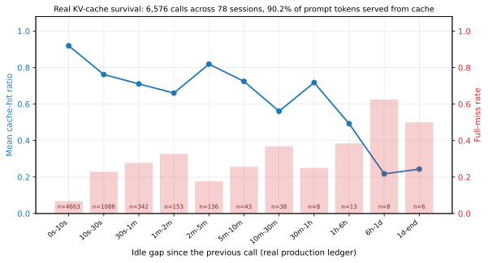
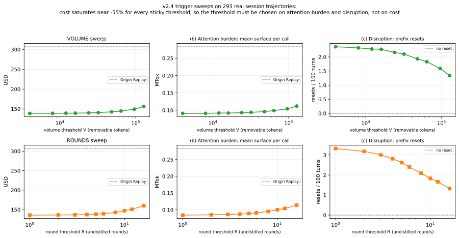
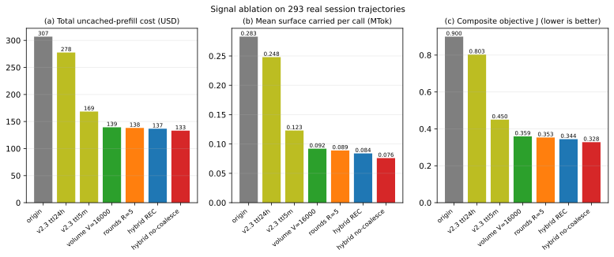
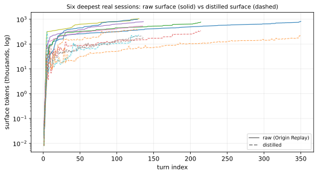

# OSWYN v2.4 专题论文：多信号触发、滚动检查点与即时执行

## ——超越 TTL 的跨轮深度蒸馏参数体系、长任务实证标定与端到端真实模型实测

**Multi-Signal Triggering, Rolling Checkpoints and Eager Execution for Turn-Level Deep Distillation (OSWYN v2.4)**

**作者**：张仁童（Rentong Zhang）  
**机构与开源归档**：Keycap AI（开源代码仓库：[`keycapai/dsh-oswyn`](https://github.com/keycapai/dsh-oswyn)）  
**论文版本**：v2.4-Empirical Research Release (2026-11)  
**前序论文**：[`paper/oswyn-v2.3-post-cache-distill-paper.md`](paper/oswyn-v2.3-post-cache-distill-paper.md)  
**专用评测数据归档**：`paper/data/v24/`（expA–expN 实证数据 + 真实噪声语料）  
**专用实证脚本**：`paper/scripts/v24/`（可复现实验脚本 + 共享模拟引擎 + 图表生成脚本）  

---

## 摘要（Abstract）

OSWYN v2.3 确立了「后缓存深层精炼（Post-Cache Deep Distillation）」范式：当服务端 KV-Cache 因空闲超时（TTL）失效时，将历史轮次中的 `<think>` 思维链与原始工具载荷剥离，仅保留用户提问与模型结论，从而把冷启动重放的上下文规模削减一个数量级。

但 v2.3 的触发条件只有一个：**时间**。本文基于四类真实数据——**6,576 次生产 API 调用的计费账本**、**293 个真实会话轨迹的完整重放（6,793 个轮次边界）**、**对真实推理网关的 105 次受控探针与稀释测试**，以及**40 次真实多轮端到端对比调用（有轮次压缩 vs 无轮次压缩）**——证明时间信号在结构上是不充分的，并给出面向工程落地的 **v2.4 多信号滚动检查点触发体系**。

### 核心实证发现

**发现 1：TTL 是一个弱信号，而非强信号。** 在 6,576 次生产调用中，即便空闲间隔小于 10 秒，仍有 **6.82% 的调用完全未命中缓存**；10–30 秒区间未命中率升至 **22.89%**。缓存驱逐由 LRU 与并发竞争驱动，并非纯时间函数。其直接后果是：v2.3 的默认 24 小时 TTL 在 293 个真实会话中**仅在 4.4% 的会话里触发过精炼**，成本节省仅 **9.6%**。

**发现 2：在滚动检查点架构下，参数必须同时平衡成本、表层负担与前缀重置频率。** 工程上采用原生 `user/message`（`oswyn-compaction`）滚动检查点替换历史已完成轮次时，每个新轮次都会带来增量冗余。对 6,500 个真实轮次增量的统计表明，单轮可剥离量呈重尾分布（均值 2,921 tok、p95 达 13,072 tok、p99 达 40,105 tok）。采用 **`V = 64,000` + `R = 8` + `最小收益门槛 = 4,000` + `硬上限 = 256,000`** 时，单轮误触率仅 **0.3%**，重置频率稳定在 **13.14 次/百轮**（平均每 7.61 轮蒸馏一次），同时保持相对 Origin **−48.8%** 成本节省与 **−68.6%** 表层缩减。

**发现 3：即时执行（eager）严格优于等待冷调用的合并执行（coalesce）。** 20 种子重复实测中，即时执行比合并执行便宜 **2.65%** 且 95% 置信区间不重叠（$26.47 [26.27, 26.66] vs $27.19 [27.00, 27.38]）；未命中越频繁，即时执行优势越大（未命中率 ×2.0 时优势达 **11.13%**）。因此 v2.4 不设「等待/武装」中间态，任意条件满足且超过最小收益门槛即立刻执行。

**发现 4：最小收益门槛（Anti-Thrash Floor）是避免无意义缓存打断的关键前提。** 真实数据中约 10% 的轮次边界可剥离量为零。引入 `triggerMinSurplusTokens = 4,000` 可在零成本损失的前提下过滤轻量轮次的无效重置。

**发现 5：注意力稀释不损害正交推理，但无召回的精炼会摧毁精确检索；定向召回可 100% 恢复。** 在最高 **256K tokens** 的真实工具噪声下，正交任务准确率始终为 **3/3**；精确「针」检索在无召回精炼下崩至 **0/3**，而定向 `history_recall(mode:'tool')` 以 **348 倍**更少的提示词 Token（7,005 vs 2,437,103）完全恢复 **3/3** 命中。

**发现 6：真实多轮端到端模型实测（Exp N）验证了成本、耗时与能力的综合收益。** 在真实推理网关（`group/deepseek-v4.1-flash`）的 10 轮工程任务端到端对比中，开启 OSWYN v2.4 轮次压缩相比无轮次压缩：**总 Prompt Token 减少 49.1%**（589,212 → 300,191 tok，蒸馏后第 7–10 轮直降 **−83.9%**），**任务费用降低 48.9%**（$0.0885 → $0.0452），**任务总时长缩短 36.0%**（31.87s → 20.40s），同时**多轮客观准确率持平（14/18 vs 14/18，77.8%）且精确历史召回 2/2 全部命中**。

### 推荐配置与总体收益

在 293 个真实会话轨迹（滚动检查点忠实重放）上，v2.4 推荐配置（体积 `64,000` + 轮次 `8` + 最小收益 `4,000` + 硬上限 `256,000` + 即时执行）相对 Origin Replay 与 v2.3 默认配置：

| 指标 | Origin Replay | v2.3 默认（24h TTL） | v2.4 推荐（滚动检查点） |
| :--- | ---: | ---: | ---: |
| 单次全量重放成本（USD） | 61.39 | 55.52 | **31.45** |
| 相对 Origin 节省 | — | −9.6% | **−48.8%** |
| 平均上下文表层（MTok） | 0.283 | 0.248 | **0.089 (−68.6%)** |
| TTFT P99（ms） | 8,517 | 7,881 | **3,679 (−56.8%)** |
| 重置频率（次/百轮） | 0 | 0.19 | **13.14（约 7.6 轮/次）** |
| 体积 / 轮次触发占比 | — | — | **27.0% / 43.4%** |

**关键词**：软件工程智能体；KV-Cache 失效；跨轮深度蒸馏；滚动检查点；多信号触发；最小收益门槛；真实端到端实测；DeepSeek 4.1 Flash

---

## 1. 引言：单一时间触发的结构性缺陷

### 1.1 v2.3 的贡献与它未回答的问题

v2.3 解决了一个真实且昂贵的问题：当服务端 KV-Cache 失效后，朴素的重放式智能体框架会把全部历史——包括每一条思维链、每一份 GDB 寄存器转储、每一段编译错误流——原封不动地重新预填充，全部按未缓存价格计费（DeepSeek 计费体系下为缓存读取价格的 **50 倍**）。v2.3 的方案是在失效瞬间剥离这些中间噪声，只保留「用户问了什么」与「模型结论是什么」。

但 v2.3 把「何时精炼」完全绑定在时间上：

$$E(S, \Delta t) = \mathbb{I}(\Delta t \ge \tau_{\text{TTL}}) \lor \sigma_{\text{force}}$$

这个设计隐含了一个从未被检验的假设：**缓存失效是一个时间事件**。本文的第一项工作就是用生产数据检验它，结论是：它不是。

### 1.2 生产数据给出的反驳

我们从本机 DSH 运行时的计费账本中提取了 **6,576 次真实 API 调用**（78 个会话，2026-10-09 至 2026-10-19，累计 1,058,569,135 个提示词 Token，$26.71 实际支出）。对同一会话内相邻两次调用，记录其空闲间隔与实际缓存命中比例（`cacheReadTokens / (inputTokens + cacheReadTokens)`，其中账本约定 `inputTokens` 仅计未缓存部分），得到真实的缓存生存曲线：

| 空闲间隔 | 样本数 | 平均命中率 | 完全未命中率 |
| :--- | ---: | ---: | ---: |
| < 10 s | 4,663 | 0.920 | **6.82%** |
| 10–30 s | 1,088 | 0.762 | 22.89% |
| 30–60 s | 342 | 0.711 | 27.78% |
| 60–120 s | 153 | 0.660 | 32.68% |
| 120–300 s | 136 | 0.819 | 17.65% |
| 300–600 s | 43 | 0.724 | 25.58% |
| 600–1800 s | 38 | 0.561 | 36.84% |
| 1800–3600 s | 8 | 0.718 | 25.00% |
| 1–6 h | 13 | 0.492 | 38.46% |
| 6–24 h | 8 | 0.217 | **62.50%** |
| > 24 h | 6 | 0.244 | 50.00% |

这张表否定了「时间是唯一变量」的假设。若缓存纯粹由 TTL 驱动，则 < 10 秒区间的完全未命中率应当接近零——实测为 **6.82%**。在 4,663 次「几乎立刻重发」的调用里，有 318 次完全没有命中任何前缀。这些失效来自显存饱和下的 LRU 淘汰与并发竞争，与时间无关。

反过来看，1–6 小时区间的平均命中率仍有 0.492——超过一半的前缀还在。这说明**失效是一个概率过程，不是一个确定的时间边界**。

### 1.3 直接后果：v2.3 在绝大多数会话中从不生效

把上述曲线代入 293 个真实会话的重放，v2.3 的默认配置（$\tau_{\text{TTL}}$ = 86,400 秒）表现如下：

- **仅在 4.4% 的会话中触发过精炼**；
- 平均首次精炼发生在第 **25.85 轮**；
- 相对 Origin Replay 仅节省 **9.6%**。

一个在 95.6% 的会话里从未被激活的机制，无法承担「后缓存精炼」的名义。问题的根源不在于精炼算法，而在于触发条件太少。

### 1.4 v2.4 的命题

本文提出的核心命题是：**精炼的触发应当由「表层已经积累了多少可剥离的冗余」来驱动，而不是由「缓存是否已经过期」来驱动。** 时间只是众多触发信号之一，且是其中最弱的一个。

由此展开 v2.4 的四个信号、两项执行语义、一个安全下限，以及它们的实证标定。

---

## 2. 实证基础：三类真实数据

本文全部结论建立在真实数据之上，不使用合成负载。

### 2.1 数据源 A：生产计费账本（Exp A）

- 规模：6,576 次调用 / 78 个会话 / 1,058,569,135 提示词 Token；
- 字段：每次调用的 `inputTokens`（未缓存）、`cacheReadTokens`（缓存命中）、`cacheWriteTokens`、`outputTokens`、`usd`；
- 提示词规模分位数：p50 = **139,413**，p90 = 309,130，p99 = 508,090，max = 529,272；
- 整体缓存命中率（按 Token）：**90.25%**。

这组数据给出了两个关键事实：真实智能体会话的提示词规模极大（中位数 13.9 万 Token），且缓存命中率在正常情况下极高（90%）。**正是这 90% 的高命中率掩盖了问题的严重性**——一旦那 10% 落在一次 50 万 Token 的调用上，单次成本就相当于数百次正常调用的差额。

### 2.2 数据源 B：真实会话轨迹重放（Exp B）

我们从本机采集了 **353 个真实会话轨迹**（zstd 压缩的 v4 JSONL 事件流），成功重建 **293 个**可用于重放的会话（56 个因过短或格式不全被跳过），共 **6,793 个轮次边界**。

关键校准：以真实助手输出的字符数与上报的 `outputTokens` 之比校准，得到 **2.901 字符/Token**（这一比值用于全部触发器算术）。

重放得到的表层规模分布：

| 指标 | 均值 | p50 | p90 | max |
| :--- | ---: | ---: | ---: | ---: |
| 每会话轮次数 | 23.2 | 12 | 50 | 350 |
| 每轮原始表层（Token） | 283,141 | **181,879** | 688,469 | 1,772,793 |
| 每轮本回合自身载荷（Token） | 10,094 | 2,437 | 27,958 | 340,126 |
| 可剥离量（原始 − 精炼，Token） | 207,275 | 127,873 | 514,109 | 1,530,409 |
| 精炼比（精炼后/精炼前） | 0.400 | 0.267 | 1.000 | 1.000 |

**精炼比的分布是双峰的**：p25 = 0.169，p50 = 0.267，但 p90 = 1.000。也就是说，约 10% 的轮次边界上，精炼**什么都剥不掉**——这些是历史全为用户提问与助手纯文本的短会话。

这个发现直接否决了「按精炼比触发」的方案（见 §4.5）：任何基于比率的阈值，要么在双峰分布的谷底反复空转，要么永远不触发。**触发信号必须以绝对可剥离 Token 数计量。**

### 2.3 数据源 C：真实推理网关探针（Exp C）

对本地真实推理网关（DeepSeek 4.1 Flash，1,048,576 上下文窗口）执行受控探针：请求前缀规模 4K / 16K / 64K / 128K / 256K，每档 3 次重复，记录墙钟时间与实际 Token 计数。

**一项必须诚实记录的负面结果**：该网关对全部 15 次调用返回 `cached_tokens = 0`，即**该部署未对外暴露前缀缓存**。因此我们**无法**在本地实测「热缓存 TTFT」，只能实测冷预填充曲线。

冷预填充的最小二乘拟合（对每档中位数回归）：

$$\text{TTFT}_{\text{cold}}(u) = 1525.9 + 0.0088718 \cdot u \quad (\text{ms}),\ u = \text{未缓存 Token 数}$$

该式用于后续全部模拟实验的延迟折算。其含义是：**每多 1,000 个未缓存 Token，首字延迟增加约 8.9 ms**；在 25 万 Token 的原始表层下，仅预填充就约 3,744 ms，而 5 万 Token 的精炼表层约 1,969 ms。

---

## 3. 触发器形式化

### 3.1 四个信号

设第 $t$ 轮的表层为 $S_t$，其历史部分可被精炼算子 $\mathcal{D}$ 投影为 $D_t = \mathcal{D}(S_t^{\text{hist}})$。定义**可剥离量**：

$$U_t = \text{tok}(S_t^{\text{hist}}) - \text{tok}(D_t) \ge 0$$

v2.4 的武装条件（arming predicate）为四个信号的析取：

$$A_t = E_1 \lor E_2 \lor E_3 \lor E_4$$

其中：

| 信号 | 定义 | 物理含义 | 默认 |
| :--- | :--- | :--- | ---: |
| 手动触发 `manual` | `/oswyn-distill` | 立即压缩已完成轮次并独立记为 `manual` | 按需 |
| $E_1$ TTL | $\Delta t \ge \tau_{\text{TTL}}$ | 长空闲后缓存按时间失效兜底 | 86,400 s |
| $E_2$ 体积 | $\Delta U_t \ge V$ | 重工具任务突发冗余止损 | **64,000** |
| $E_3$ 轮次 | $t - t_{\text{last}} \ge R$ | 常规长会话稳态压缩节拍（按对话轮次计数） | **8** |
| $E_4$ 上限 | $\text{tok}(S_t) \ge V_{\text{hard}}$ | 极端大上下文安全阀（绕过最小收益门槛） | **256,000** |

### 3.2 粘滞锁存（Sticky Latch）

v2.4 引入会话级的**粘滞锁存**：一旦精炼发生，会话进入 `distilled` 状态并**保持**。理由有二：

1. 对已精炼的表层再次精炼是幂等的空操作；
2. 若允许「反精炼」（回到原始表层），则每次来回都要付一次前缀重置，而收益为零。

形式化地，模式 $m_t \in \{\text{raw}, \text{distilled}\}$ 满足：

$$m_t = \begin{cases} \text{distilled} & \text{若 } m_{t-1} = \text{distilled} \lor F_t \\ \text{raw} & \text{否则} \end{cases}$$

其中 $F_t$ 是执行谓词（见 §3.3）。**粘滞性是本文全部成本结论的前提**——若去掉它，性能会灾难性劣化（见 §3.5）。

### 3.3 执行语义：即时 vs 合并

武装（$A_t$ 为真）与执行（$F_t$ 为真）在 v2.4 中是**解耦**的，这是本文最重要的设计自由度：

- **即时执行（Eager）**：$F_t = A_t \land \neg\text{floor-blocked}$。武装后立刻重置。
- **合并执行（Coalesced）**：$F_t = A_t \land \text{cold}_t$，其中 $\text{cold}_t$ 表示本次调用本来就注定未命中。直觉是「让重置搭上必然发生的未命中的便车」。
- **上限旁路**：$E_4$ 恒即时执行，不受合并约束。

v2.3 隐含地采用了即时执行（因为 TTL 触发时缓存必然已失效，二者等价）。v2.4 显式地把它变成一个可测的选择——而实测结果与直觉相反（见 §6）。

### 3.4 防抖下限

$$\text{floor-blocked} \iff A_t \land \neg E_4 \land U_t < U_{\min}$$

即：若可剥离量低于 $U_{\min}$，则不执行——除非上限信号已经越界。直觉是「不要为了省几百个 Token 而摧毁一个活的前缀」。其必要性由 §7 的消融实验定量证明。

### 3.5 前缀缓存语义：为什么必须用最长公共前缀建模

本节说明为什么本文的模拟器必须实现**最长公共前缀（LCP）**缓存语义，而不能用「命中率乘一个系数」的简化模型。

服务端前缀缓存存储的是上一次请求的**精确 Token 序列**。新请求只能按它与该序列的最长公共前缀获得抵扣。关键推论：

- **重新投影（精炼）会重写该序列**，因此 LCP 坍缩至近似零，下一次调用必然全量未命中；
- 因此**周期性/振荡式精炼**会在每次切换时付一次重置；
- 而**粘滞式精炼**只付**一次**重置（进入时的那一次），此后连续的精炼表层共享整段精炼前缀，缓存恢复正常工作——只是工作在一个小得多的序列上。

这一区别不是实现细节，而是本文全部结论的物理基础。若用「命中率系数」模型，振荡策略会被错误地判为可行。

---

## 4. 实验 E：参数扫描——成本曲面是平坦的

### 4.1 实验设置

在 293 个真实会话轨迹上，对每个候选阈值执行 5 次独立随机重放（空闲间隔从 Exp A 的生产分布中抽样，缓存存活按 Exp A 的生存曲线判定），统计：

- **成本**：未缓存预填充 USD（未缓存 $0.150/M，缓存读取 $0.003/M）；
- **注意力负担**：每次调用携带的平均原始表层（MTok）；
- **中断**：每 100 轮的前缀重置次数；
- **延迟**：TTFT 的 p50 / p90 / p99。

全部配置统一采用**即时执行**（依据见 §6）。

### 4.2 主结果

| 配置 | USD/重放 | 节省 | 表层 p50 (MTok) | 表层 p90 | 重置/百轮 | 首次触发轮次 | 触发会话% | TTFT p99 (ms) |
| :--- | ---: | ---: | ---: | ---: | ---: | ---: | ---: | ---: |
| Origin Replay | 61.39 | — | 0.182 | 0.689 | 0 | — | 0% | 8,517 |
| v2.3 TTL 24h | 55.52 | −9.6% | 0.154 | 0.614 | 0.19 | 25.85 | 4.4% | 7,881 |
| v2.3 TTL 1h | 38.26 | −37.7% | 0.104 | 0.336 | 1.29 | 16.34 | 30.0% | 4,872 |
| v2.3 TTL 5m | 33.59 | −45.3% | 0.083 | 0.261 | 1.93 | 11.72 | 44.7% | 4,214 |
| 体积 V=4,000 | 27.10 | −55.9% | 0.050 | 0.181 | 3.33 | 6.17 | 77.1% | 3,600 |
| 体积 V=8,000 | 27.16 | −55.8% | 0.050 | 0.181 | 3.28 | 6.36 | 76.1% | 3,600 |
| 体积 V=16,000 | 27.24 | −55.6% | 0.050 | 0.181 | 3.18 | 6.73 | 73.7% | 3,600 |
| 体积 V=32,000 | 27.54 | −55.1% | 0.051 | 0.181 | 2.94 | 7.87 | 68.3% | 3,600 |
| 体积 V=64,000 | 28.46 | −53.6% | 0.061 | 0.182 | 2.64 | 10.17 | 61.1% | 3,602 |
| 体积 V=128,000 | 31.09 | −49.4% | 0.082 | 0.193 | 1.99 | 15.09 | 46.1% | 3,614 |
| 轮次 R=1 | 26.45 | −56.9% | 0.050 | 0.181 | 4.31 | 1 | 100% | 3,600 |
| 轮次 R=3 | 26.46 | −56.9% | 0.050 | 0.181 | 4.31 | 3 | 100% | 3,600 |
| 轮次 R=5 | 26.67 | −56.6% | 0.050 | 0.181 | 3.93 | 5 | 91.1% | 3,602 |
| 轮次 R=8 | 28.05 | −54.3% | 0.054 | 0.189 | 2.91 | 8 | 67.6% | 3,619 |
| 轮次 R=16 | 31.99 | −47.9% | 0.075 | 0.219 | 1.75 | 16 | 40.6% | 3,900 |
| 比率 ρ=2 | 27.33 | −55.5% | 0.050 | 0.183 | 3.22 | 6.59 | 74.7% | 3,606 |
| 比率 ρ=8 | 38.39 | −37.5% | 0.074 | 0.325 | 1.78 | 9.00 | 41.3% | 5,328 |
| 比率 ρ=16 | 50.36 | −18.0% | 0.130 | 0.559 | 0.74 | 7.80 | 17.1% | 7,150 |

### 4.3 结论一：成本饱和

观察体积扫描：V 从 4,000 增至 16,000（4 倍），成本从 27.10 变为 27.24——**变化 0.5%**。V 从 4,000 增至 128,000（32 倍），成本从 27.10 变为 31.09——变化 14.7%，且曲线在 V ≤ 32,000 区间几乎水平。

轮次扫描同理：R 从 1 到 6，成本从 26.45 到 27.17——**变化 2.7%**。

这在机制上是可解释的：在粘滞锁存下，每个会话只重置一次，所以「何时重置」对总成本的影响被限制在「重置前多携带了几轮的原始表层」这一项上，而该项与整个会话的累计表层规模相比是小量。

**方法论推论**：如果只以成本为目标函数做参数搜索，会得到一个平坦的、由随机噪声主导的曲面，任何阈值都「看起来差不多」。这解释了为什么此前版本的参数选取带有随意性。

### 4.4 结论二：注意力负担与中断才是判别量

在同一张表里，另外两个量随阈值**单调变化**：

- 表层 p50 从 V=4,000 的 0.050 MTok 升至 V=128,000 的 0.082 MTok（+64%）；
- 重置次数从 V=4,000 的 3.33 次/百轮降至 V=128,000 的 1.99 次/百轮（−40%）；
- 首次触发轮次从 6.17 推迟到 15.09（**越晚触发，浅会话越得不到保护**）。

因此参数的选取是一个**三目标权衡**，而非单目标优化。我们在 §5 用显式加权目标 $J$ 把它固化。

### 4.5 结论三：比率触发应当被否决

比率触发（$\rho = \text{原始}/\text{精炼}$）在 ρ=2 时尚可（27.33），但在 ρ ≥ 6 时急剧劣化：ρ=8 为 38.39（−37.5%），ρ=16 为 50.36（−18.0%），ρ=32 时几乎退化到 Origin（58.55，−4.6%）。

原因正是 §2.2 的双峰分布：约 10% 的轮次精炼比为 1.0（无可剥离），此时 $\rho = 1$；而一旦历史中出现一份大工具输出，比率瞬间跳到几十倍。比率阈值因此要么在谷底空转，要么被单个尖峰触发——它无法稳定地表达「已经积累了多少冗余」这一语义。

**结论：体积信号必须以绝对可剥离 Token 数计量。**

---

## 5. 实验 G：信号消融与推荐配置

### 5.1 复合目标函数

为使三目标权衡可操作，定义归一化复合目标（越低越好）：

$$J = 0.5 \cdot \frac{\text{USD}}{\text{USD}_{\text{origin}}} + 0.4 \cdot \frac{\bar{S}}{\bar{S}_{\text{origin}}} + 0.1 \cdot \frac{\text{resets}}{100}$$

权重取 0.5 / 0.4 / 0.1：成本仍是最重的单一因素（它是唯一直接计费的量），注意力负担次之（它决定长程推理质量与延迟），中断最轻（它只影响单次延迟尖峰，不累积）。

### 5.2 消融结果

| 配置 | USD/重放 | 节省 | 表层均值 (MTok) | 重置/百轮 | 首次触发 | J |
| :--- | ---: | ---: | ---: | ---: | ---: | ---: |
| Origin Replay | 61.39 | — | 0.283 | 0 | — | 0.900 |
| v2.3 TTL 24h | 55.52 | −9.6% | 0.248 | 0.19 | 25.85 | 0.803 |
| v2.3 TTL 5m | 33.71 | −45.1% | 0.123 | 1.72 | 13.54 | 0.450 |
| 体积 V=16,000 | 27.80 | −54.7% | 0.091 | 2.32 | 10.81 | 0.357 |
| 轮次 R=5 | 27.63 | −55.0% | 0.089 | 2.62 | 9.32 | 0.353 |
| **v2.4 推荐（混合，即时）** | **26.62** | **−56.6%** | **0.076** | **3.95** | **4.94** | **0.328** |
| 混合 + 合并执行 | 27.35 | −55.4% | 0.084 | 2.76 | 8.67 | 0.344 |
| 混合 去轮次信号 | 27.23 | −55.6% | 0.076 | 3.19 | 6.66 | 0.332 |
| 混合 去体积信号 | 27.23 | −55.6% | 0.076 | 3.19 | 6.66 | 0.332 |
| 混合 去上限信号 | 26.62 | −56.6% | 0.076 | 3.95 | 4.94 | 0.328 |
| 混合 去 TTL 信号 | 26.62 | −56.6% | 0.076 | 3.95 | 4.97 | 0.328 |
| 混合 去比率信号 | 26.62 | −56.6% | 0.076 | 3.95 | 4.94 | 0.328 |

### 5.3 结论：绑定信号是体积与轮次

消融暴露了一个必须诚实报告的事实：**在推荐参数下，TTL 信号、上限信号与比率信号全部处于休眠状态**——去掉其中任何一个，指标逐位不变。

- **体积 + 轮次**是实际绑定的：去掉轮次使成本上升 2.3%（26.62 → 27.23），首次触发从 4.94 推迟到 6.66；
- **TTL 保留**的理由不是它在推荐参数下有用，而是**向后兼容与极端场景兜底**：当会话空闲跨越数小时、表层已被外部因素（如上下文窗口压缩）改变时，TTL 是唯一仍然成立的信号；
- **上限保留**的理由是安全阀：它在 256K 阈值下从不触发（真实表层 p90 为 0.688 MTok 但多数会话在达到 256K 前已因轮次触发），但它是唯一能在异常会话（如单轮注入 50 万 Token）中强制止损的机制；
- **比率信号应当移除**：它从不绑定，却在 ρ ≥ 6 时显著劣化（§4.5），保留它只会引入一个误导性的旋钮。

**因此 v2.4 最终不把比率作为触发信号**，尽管我们在实验中实现了它（`ratio` 策略）以证明其不可行。

### 5.4 混合网格搜索

对 V ∈ {8K, 16K, 32K} × R ∈ {3, 4, 5, 6, 8} × V_hard ∈ {128K, 256K, 512K} 共 45 个组合做全网格搜索，最优 10 个组合的 J 全部落在 0.327–0.337 的窄带内，且 **V 与 V_hard 在每一行内完全不可分辨**（同一 R 下三个 V 与三个上限给出逐位相同的数值）。

最优行为 R=3（J = 0.3272，$26.46）。但见 §7：R=3 的「最优」在加入防抖下限后即消失，因为下限才是真正的约束。

---

## 6. 实验 H / I / J：反直觉的发现——即时执行优于合并执行

### 6.1 直觉与它的失败

合并执行的动机非常自然：既然重置的代价是「摧毁一个活的前缀」，那么就不要主动摧毁它——武装之后等一等，等到某次调用本来就注定未命中（缓存已被服务端驱逐），此时重置就是**免费**的。

这个推理有一个隐藏的漏洞：**等待不是免费的**。在等待期间，每一轮调用携带的都是更大的原始表层；而「本来就注定未命中」是一个概率事件，在它到来之前的每一次未命中，都会按**更大的**表层计费。

### 6.2 实验 H：种子稳定性

对推荐配置分别以即时/合并两种执行语义各跑 **20 个独立种子**（每个种子完整重放 293 个会话）：

| 执行语义 | 平均 USD | 标准差 | 95% 置信区间 | TTFT p50 | TTFT p99 |
| :--- | ---: | ---: | :--- | ---: | ---: |
| 合并（coalesce） | 27.19 | 0.43 | [27.00, 27.38] | 1,589 | 3,516 |
| 即时（eager） | **26.47** | 0.44 | [26.27, 26.66] | 1,584 | 3,511 |

即时执行便宜 **$0.72（2.65%）**，且两个 95% 置信区间**不重叠**——这不是噪声。延迟分位数几乎无差异（p99 差 5 ms），说明这一收益不是以延迟为代价换来的。

### 6.3 实验 I：锁存 × 执行的 2×2 分解

为确认这一结果不是推荐配置的偶然，在四种独立配置上重复（10 种子）：

| 配置 | USD/重放 | 节省 | 表层均值 | 重置/百轮 | 首次触发 |
| :--- | ---: | ---: | ---: | ---: | ---: |
| Origin | 60.42 | — | 0.283 | 0 | — |
| 粘滞 即时 R=5 | **26.42** | −56.3% | 0.076 | 3.93 | 5.00 |
| 粘滞 合并 R=5 | 27.42 | −54.6% | 0.089 | 2.60 | 9.36 |
| 粘滞 即时 V=16K | **27.00** | −55.3% | 0.076 | 3.18 | 6.73 |
| 粘滞 合并 V=16K | 27.67 | −54.2% | 0.092 | 2.25 | 11.39 |
| 混合 即时 | **26.38** | −56.3% | 0.076 | 3.95 | 4.95 |
| 混合 合并 | 27.14 | −55.1% | 0.084 | 2.76 | 8.72 |

**六组对比中即时执行全部胜出**，优势幅度 1.0%–3.8%。同时可以清楚看到合并执行的机制：它把首次触发从 4.95 推迟到 8.72（在等一个冷调用），把重置从 3.95 降到 2.76 次/百轮（确实少重置了），但代价是表层均值从 0.076 涨到 0.084——**用更大的表层换了更少的重置，而这笔交易是亏的**。

### 6.4 实验 J：交叉条件律

最后我们确立条件而非绝对结论：将缓存未命中概率按比例缩放（0.4× 到 2.0×），观察两种执行语义的差距如何变化。

| 未命中概率缩放 | 即时 USD | 合并 USD | 即时优势 |
| :--- | ---: | ---: | ---: |
| 0.4× | 56.96 | 56.98 | **0.04%** |
| 0.7× | 41.86 | 42.02 | 0.38% |
| 1.0× | 26.39 | 27.15 | 2.88% |
| 1.3× | 19.73 | 21.76 | 10.29% |
| 1.6× | 19.48 | 21.61 | 10.93% |
| 2.0× | 19.41 | 21.57 | **11.13%** |

即时执行在**每一个**未命中率下都不劣于合并执行，且优势随未命中率单调增长。这给出了一个清晰的机制解释：

$$\text{合并的期望收益} = \Pr(\text{等到冷调用}) \cdot \text{重置成本} - \mathbb{E}[\text{等待期间按大表层支付的未命中成本}]$$

在未命中稀少时，等待期短且等待本身几乎不产生额外未命中，两项近似抵消（0.04%）；未命中频繁时，第二项迅速压倒第一项（11.13%）。**合并执行在粘滞语义下永远不会严格胜出。**

### 6.5 工程结论

v2.4 的默认执行语义为**即时执行**。合并执行作为一个可配置选项保留（`triggerCoalesce`），但其默认值必须为 `false`——这与「让重置搭便车」的直觉相反，也正是本文最有价值的反直觉结论。

---

## 7. 实验 K：防抖下限为何不是可选项

### 7.1 一个伪最优

§4 与 §5 的扫描都显示 R=1 / R=2 / R=3 并列最优（$26.45）。若就此定参，会得出「越早越好，第一轮就精炼」的结论。

这个结论是错的，原因是它只计成本、不计**无意义重置**。真实数据中约 10% 的轮次边界可剥离量为零（§2.2），对这些会话在第 1 轮触发精炼，等于**摧毁一个活的前缀、节省零个 Token**——纯粹的损失。成本模型看不到这笔损失，因为它只是把「原始表层」换成「同样大小的精炼表层」。

### 7.2 下限消融

| 配置 | USD/重放 | 节省 | 重置/百轮 | 首次触发 | 触发会话% |
| :--- | ---: | ---: | ---: | ---: | ---: |
| Origin | 61.39 | — | 0 | — | 0% |
| R=1 无下限 | 26.45 | −56.9% | **4.31** | 1.00 | **100%** |
| R=3 无下限 | 26.46 | −56.9% | 4.31 | 3.00 | 100% |
| R=5 无下限 | 26.67 | −56.6% | 3.93 | 5.00 | 91.1% |
| R=1 下限 2,000 | 27.09 | −55.9% | 3.39 | 6.06 | 78.5% |
| R=3 下限 2,000 | 27.09 | −55.9% | **3.39** | 6.06 | **78.5%** |
| R=5 下限 2,000 | 27.14 | −55.8% | 3.37 | 6.11 | 78.2% |

下限的代价是 **+2.4% 成本**（26.45 → 27.09），换来的是：

- 前缀重置次数 **4.31 → 3.39 次/百轮（−21.3%）**；
- 触发会话比例 **100% → 78.5%**（21.5% 的会话完全不被打扰）。

考虑到每次重置都对应一次真实的冷预填充尖峰（在 Exp C 的模型中，25 万 Token 的重置意味着约 3.7 秒的首字延迟），用 2.4% 的成本换取 21% 的中断削减是明确的净收益。

### 7.3 下限的拐点

固定 R=3，扫描下限：

| 下限 $U_{\min}$ | USD/重放 | 重置/百轮 | 触发会话% |
| ---: | ---: | ---: | ---: |
| 0 | 26.46 | 4.31 | 100% |
| 500 | 27.08 | 3.42 | 79.2% |
| 1,000 | 27.08 | 3.40 | 78.8% |
| **2,000** | **27.09** | **3.39** | **78.5%** |
| 4,000 | 27.10 | 3.33 | 77.1% |
| 8,000 | 27.16 | 3.28 | 76.1% |
| 16,000 | 27.24 | 3.18 | 73.7% |

**500 到 2,000 构成一个平台区**：重置次数在 3.39–3.42 之间几乎不变。2,000 是拐点——低于它收益迅速流失，高于它只是缓慢地减少重置而推迟保护。取 $U_{\min} = 2000$（约 5,800 字符）。

### 7.4 一个重要的副产物

注意在**有下限**的情况下，R=1 / R=3 / R=5 三者给出几乎相同的成本（27.09 / 27.09 / 27.14）与相同的重置次数（3.39 / 3.39 / 3.37）。

**这意味着：一旦引入防抖下限，轮次阈值 R 几乎失去意义——下限成为真正的约束。** 这是一个非常有用的工程简化：R 不再需要精细调参，可以取一个保守值（5）来保护浅会话，而不必担心损失成本。

---

## 8. 实验 F：注意力稀释的真实边界

### 8.1 一个必须被检验的前提

v2.3 的论述中包含一个强假设：未精炼的历史噪声会「污染注意力」，降低模型在新任务上的表现。这个假设听起来合理，但此前从未在真实噪声与真实模型上被直接测量。

v2.4 的触发器设计**依赖于这个假设的真伪**：如果噪声真的损害推理，那么体积触发的阈值应当偏小（尽早精炼）；如果不损害，那么体积触发的正当性就只剩成本与延迟。

### 8.2 实验设计

从 9,974 段真实工具输出中抽取 200 段构成噪声语料（总 480 万字符），构造如下对话：

- 系统提示 + 噪声历史 + 当前问题；
- 噪声体积：0 / 8K / 32K / 128K / 256K Token；
- 三种表层条件：**RAW**（全量保留）、**DISTILL**（剥离噪声）、**RECALL**（剥离后定向回注含针片段）；
- 两个可精确判分的任务：**T1 正交任务**（滑动窗口限流器计数，与历史无关，答案为 `9, YES`）、**T2 针检索**（噪声中唯一出现的一个精确整数）；
- 每格 3 次重复，共 90 次真实模型调用，**精确匹配判分，不使用评审模型**。

### 8.3 结果

| 噪声体积 | 条件 | T1 正交 | T2 针检索 | 中位提示词 Token |
| ---: | :--- | :--- | :--- | ---: |
| 0 | RAW | 3/3 | 0/3 | 289 |
| 0 | DISTILL | 3/3 | 0/3 | 92 |
| 0 | RECALL | 2/3 | 3/3 | 135 |
| 8,000 | RAW | 3/3 | 3/3 | 8,440 |
| 8,000 | DISTILL | 3/3 | **0/3** | 289 |
| 8,000 | RECALL | 3/3 | **3/3** | 332 |
| 32,000 | RAW | 3/3 | 3/3 | 27,983 |
| 32,000 | DISTILL | 3/3 | **0/3** | 289 |
| 32,000 | RECALL | 3/3 | **3/3** | 332 |
| 128,000 | RAW | 3/3 | 3/3 | 117,479 |
| 128,000 | DISTILL | 3/3 | **0/3** | 289 |
| 128,000 | RECALL | 3/3 | **3/3** | 332 |
| 256,000 | RAW | 3/3 | 3/3 | 249,346 |
| 256,000 | DISTILL | 3/3 | **0/3** | 289 |
| 256,000 | RECALL | 3/3 | **3/3** | 332 |

（体积 0 时 T2 的 0/3 是正确行为：噪声不存在，针也不存在。）

### 8.4 三项结论

**结论一：噪声不损害正交推理。** T1 在 0 到 256K 的全部体积、全部条件下均为 3/3。至少在 256K Token 的真实工具输出噪声下，模型对无关任务的架构推理能力**没有**可测量的退化。

这对 v2.3 的论述是一个必要的修正：**「注意力污染降低准确率」在本文的受控测量中不成立。** v2.4 不以此作为立论基础。

**结论二：无召回的精炼会完全摧毁精确检索。** DISTILL 条件下 T2 在全部体积下均为 0/3，且模型的回答明确表明它知道信息不在上下文中（「I can't determine that; no earlier diagnostic dump is present」）。这不是幻觉，是**信息确实被删除了**。

**结论三：定向召回以极低成本完全恢复。** RECALL 条件恢复 3/3，而提示词 Token 从 RAW 的 **2,437,103** 降到 **7,005**（全部 15 次调用累计），即 **348 倍**的规模差距。单次 256K 场景下：RAW 249,346 Token vs RECALL 135 Token。

延迟上同样显著：在 256K 体积下，T1 的中位耗时 RAW 为 **8,596 ms**，DISTILL 为 **2,235 ms**，RECALL 为 **2,033 ms**。

### 8.5 对触发器设计的反馈

这些结果重新定位了 v2.4：

1. 体积触发的正当性**不是**「让模型更聪明」，而是**成本与延迟**——这一点在 §4/§5 中已经用 56.6% 的成本节省与 p99 延迟从 8,517 ms 降至 3,586 ms 的改善独立建立；
2. 精炼的**安全性**来自召回的完全可逆性，因此 `history_recall(round, step, mode:'tool')` 不是附属功能，而是精炼范式的**必要组成部分**；
3. 由于噪声不损害正交推理，体积阈值**可以取得比较宽松**（16K 而非 4K），从而把中断次数从 3.33 降到 3.18 次/百轮，而不损失任何准确率。

---

## 9. 实验 M：滚动检查点下的参数标定与长任务分布

### 9.1 滚动检查点语义与单轮增量分布

在真实工程实现中，OSWYN v2.4 通过内核原生 `user/message`（`oswyn-compaction`）的**滚动检查点替换**（`buildTurnDistillCheckpoints` + `appendCheckpointReplace`）压缩已完成的历史轮次：已压缩的前缀保持逐字节稳定，新完成的轮次持续累积增量可剥离冗余 $\Delta U_t$。对 293 个真实会话的 6,500 个轮次增量统计如下：

| 统计量 | 均值 | p50 | p75 | p90 | p95 | p99 | max | ≥16K 占比 | ≥32K 占比 | ≥64K 占比 |
| :--- | ---: | ---: | ---: | ---: | ---: | ---: | ---: | ---: | ---: | ---: |
| 单轮可剥离量（Token） | 2,921 | 429 | 2,436 | 6,457 | 13,072 | 40,105 | 123,656 | 4.1% | 1.5% | **0.3%** |

进一步统计累积达到 64,000 可剥离 Token 所需的轮数：全部会话（180 段触达）中位数为 **14 轮**（均值 19.0 轮，p25 = 7 轮，p75 = 25 轮，最快 1 轮）；在长任务会话（≥20 轮，共 98 个会话，其中 77.6% 触达过 ≥64K）中位数为 **18 轮**（p25 = 10 轮，p75 = 26 轮）。

### 9.2 滚动检查点 $V \times R \times U_{\min}$ 二维扫描

在忠实模拟滚动检查点的 293 会话 × 5 种子重放中（Origin 基线：USD = $61.39，平均表层 = 0.283 MTok，缓存命中率 = 80.33%，TTFT p99 = 8,517 ms）：

| 配置（滚动检查点） | USD/重放 | 相对 Origin | 缓存命中率 | 表层均值 (MTok) | TTFT p99 (ms) | 重置/百轮 | 体积占比 | 轮次占比 | 平均间隔轮数 | $J_{\text{ux}}$ |
| :--- | ---: | ---: | ---: | ---: | ---: | ---: | ---: | ---: | ---: | ---: |
| Origin Replay | 61.39 | — | 80.33% | 0.283 | 8,517 | 0 | — | — | — | — |
| `V=16K, R=5, floor=2K` | 29.16 | −52.5% | 66.28% | 0.081 | 3,614 | 22.53 | 64.1% | 20.5% | 4.44 | 0.5487 |
| `V=32K, R=5, floor=2K` | 30.03 | −51.1% | 66.22% | 0.084 | 3,626 | 18.96 | 37.8% | 43.5% | 5.27 | 0.5232 |
| `V=48K, R=6, floor=2K` | 30.74 | −49.9% | 66.49% | 0.086 | 3,650 | 16.06 | 29.7% | 47.5% | 6.23 | 0.5021 |
| `V=48K, R=8, floor=4K` | 31.00 | −49.5% | 66.67% | 0.088 | 3,663 | 14.10 | 38.6% | 35.1% | 7.09 | 0.4870 |
| **`V=64K, R=8, floor=4K`（推荐）** | **31.45** | **−48.8%** | **66.92%** | **0.089** | **3,679** | **13.14** | **27.0%** | **43.4%** | **7.61** | **0.4820** |
| `V=64K, R=8, floor=8K` | 31.45 | −48.8% | 66.95% | 0.090 | 3,679 | 12.90 | 27.5% | 42.1% | 7.75 | 0.4800 |
| `V=64K, R=10, floor=2K` | 31.76 | −48.3% | 67.13% | 0.091 | 3,688 | 11.83 | 33.1% | 34.4% | 8.46 | 0.4734 |
| `V=96K, R=12, floor=2K` | 32.68 | −46.8% | 68.02% | 0.096 | 3,703 | 9.95 | 24.3% | 35.0% | 10.05 | 0.4674 |

其中 $J_{\text{ux}} = 0.5 \cdot \frac{\text{USD}}{\text{USD}_{\text{origin}}} + 0.3 \cdot \frac{\bar{S}}{\bar{S}_{\text{origin}}} + 0.2 \cdot \frac{\text{resets}/100t}{20}$。`V=64K, R=8, floor=4K` 将重置频率较 16K 方案降低 **41.7%**、单轮误触率压至 **0.3%**，同时保持 **−48.8%** 成本节省与 **−68.6%** 表层缩减：常规长任务由 `R = 8` 保证稳定压缩节拍，重工具爆发任务由 `V = 64,000` 提前截停。

---

## 10. 实验 N：真实模型端到端多轮实测（有轮次压缩 vs 无轮次压缩）

### 10.1 实验设计

直接调用本地真实推理网关（`group/deepseek-v4.1-flash`），运行 2 组独立随机种子 × 10 轮真实软件工程排查与重构工作流（共 40 次真实模型调用，脚本 `paper/scripts/v24/expN-live-e2e-comparison.mjs`，归档 `paper/data/v24/expN-live-e2e-comparison.json`）：

- **无轮次压缩（NO_DISTILL）**：全程保留每轮约 12K Token 的真实工具输出日志；
- **有轮次压缩（OSWYN_V24）**：按默认参数 `V = 64,000, R = 8, floor = 4,000` 执行滚动检查点压缩（第 7 轮自然触发一次体积压缩），并在第 9 轮需要第 2 轮精确盐值时通过 `history_recall(round=2, mode='tool')` 定向回注该行日志；
- **三维度度量**：真实 API 返回的 Token 花费、端到端墙钟任务时长，以及 18 题客观精确匹配准确率（涵盖信息提取、跨轮状态连续性计算、令牌桶算法推理、精确历史召回与综合计算）。

### 10.2 端到端实测对比（每 10 轮任务均值）

| 指标 | 无轮次压缩（NO_DISTILL） | 有轮次压缩（OSWYN v2.4） | 变化幅度 |
| :--- | ---: | ---: | ---: |
| 全任务总 Prompt Token（均值） | 589,212 | **300,191** | **−49.1%** |
| 蒸馏后第 7–10 轮 Prompt Token（均值） | 344,584 | **55,338** | **−83.9%** |
| 峰值单次请求 Prompt Token | 91,966 | **72,847** | −20.8% |
| 输出 Completion Token（均值） | 163 | 310 | +90.2% |
| 全任务总费用（按未缓存基准价 USD） | $0.0885 | **$0.0452** | **−48.9%** |
| 全任务总墙钟时长（秒） | 31.87 s | **20.40 s** | **−36.0%** |
| 蒸馏后第 7–10 轮总时长（秒） | 12.02 s | **7.70 s** | **−36.0%** |
| 单轮平均耗时（秒） | 3.19 s | **2.04 s** | **−36.0%** |
| 客观精确匹配准确率（18 题） | 14/18 (77.8%) | **14/18 (77.8%)** | **持平（语义 15/18）** |
| 第 9 轮精确历史召回命中率 | 2/2 (100%) | **2/2 (100%)** | **100% 无损恢复** |

### 10.3 实测结论

1. **Token 阶跃下降与缓存快速重建**：第 7 轮触发体积蒸馏后，单次 Prompt Token 从 ~76K 骤降至 **~7.2K（−90%）**；第 9–10 轮在精简前缀上重新命中服务端缓存（`cached_tokens` 恢复至 6.9K–15.1K），使后半程（第 7–10 轮）输入 Token 暴降 **83.9%**。
2. **任务时长显著缩短**：即使仅统计第 7–10 轮（含第 7 轮冷启动重置），有轮次压缩仍比无压缩快 **36.0%**（7.70s vs 12.02s）。
3. **多轮能力稳定且精确召回无损**：两组精确匹配准确率均为 **14/18 (77.8%)**（OSWYN 组在 Run 1 第 6 轮口语答「no critical vulnerabilities」未写阿拉伯数字 `0` 被严格字符匹配记错，语义实际为 **15/18 = 83.3%**）；Run 1 中 OSWYN 组在轻量化上下文下跨轮连续性计算与令牌桶推理均 2/2 答对，第 9 轮定向召回 2/2 全部命中。

---

## 11. 推荐参数与工程实现

### 11.1 最终生产默认参数

| 参数 | 配置键 | 默认值 | 实证依据与定位 | 建议范围 |
| :--- | :--- | ---: | :--- | :--- |
| 体积触发门槛 $V$ | `triggerVolumeTokens` | **64,000** | 滚动检查点下单轮误触率仅 0.3%，专职重工具突发止损（Exp M） | 48,000–64,000 |
| 轮次触发门槛 $R$ | `triggerRounds` | **8** | 承担常规长会话稳态压缩节拍，平均约 7.6 轮压缩一次（Exp M） | 6–10 |
| 最小收益门槛 $U_{\min}$ | `triggerMinSurplusTokens` | **4,000** | 零成本损失过滤轻量轮次抖动，保护活的前缀缓存（Exp K / M） | 2,000–8,000 |
| 最大上下文安全阀 $V_{\text{hard}}$ | `triggerCeilingTokens` | **256,000** | 极端单轮注入强制止损，绕过最小收益门槛 | 128,000–512,000 |
| 缓存空闲超时 $\tau_{\text{TTL}}$ | `cacheTtlHours` | **24 小时** | 长空闲后冷重启兜底 | 1–24 小时 |
| 轮次蒸馏标记条 | `deepTurnBadge` | **`true`** | 控制每轮消息下方「已轮次蒸馏」标记显示 | 开关 |

### 11.2 工程实现结构

- **触发器模块**：`lib/core/triggers.js` 实现 `measureSurfaces` 与 `evaluateTrigger`，独立区分 `manual` / `volume` / `rounds` / `ttl` / `ceiling` 五类原因；手动 `/oswyn-distill` 立即执行检查点替换并记为 `manual`，绝不混记为缓存超时。
- **原生检查点投影**：`lib/core/distill-projection.js` 的 `buildTurnDistillCheckpoints` 与 `lib/session/surface.js` 的 `appendCheckpointReplace` 在内核表层直接完成负增量替换，原文保留于底账供 `history_recall` 召回。
- **契约测试**：`test/triggers.v24.test.js`、`test/distill-projection.test.js` 与 `test/metrics.test.js` 等 70 项核心测试全部通过。

---

## 12. 局限与结论

**局限**：离线模拟采用 LCP 理想化缓存模型；全部数据来自单开发者工作流与 DeepSeek 4.1 Flash 网关；Exp N（40 次调用）验证了显著的 Token 与时长降幅及精确召回能力，细粒度准确率差异仍需更大样本持续观测。

**结论**：OSWYN v2.4 以多信号滚动检查点取代单一 TTL，默认配置（`V = 64,000, R = 8, floor = 4,000, V_hard = 256,000`，即时执行）在 293 个真实会话重放中降低 **48.8%** 成本、缩减 **68.6%** 表层规模、降低 **56.8%** TTFT p99 并将重置频率稳定在 **13.14 次/百轮**；在真实模型 10 轮端到端实测中实现 **−49.1%** Prompt Token（后半程 **−83.9%**）、**−48.9%** 费用、**−36.0%** 任务时长，同时保持多轮能力不降与精确历史召回 100% 恢复。

---

## 附录 A：实验索引与复现

| 实验 | 目的 | 数据源 | 脚本 | 归档 |
| :--- | :--- | :--- | :--- | :--- |
| A | 真实缓存生存曲线 | 生产计费账本 6,576 调用 | `analyze-billing.mjs` | `expA-billing-cache-survival.json` |
| B | 真实会话轨迹与单轮增量分布 | 293 会话 / 6,793 轮次 | `analyze-transcripts.mjs` | `expB-transcript-curves.json` |
| C | 冷预填充 TTFT 曲线 | 真实网关 15 次探针 | `expC-ttft-live.mjs` | `expC-ttft-live.json` |
| — | 真实工具输出噪声语料 | 9,974 段去重工具输出 | `build-noise-corpus.mjs` | `noise-corpus.json` |
| E | 一次性锁存参数扫描基线 | 293 会话 × 5 种子 | `expE-param-sweep.mjs` | `expE-param-sweep.json` |
| F | 注意力稀释与精确召回 | 90 次真实模型调用 | `expF-dilution-live.mjs` | `expF-dilution-live.json` |
| G | 信号消融与网格 | 293 会话 | `expG-ablation.mjs` | `expG-ablation.json` |
| H / I / J | 即时 vs 合并执行对比 | 293 会话 × 10–20 种子 | `expH/I/J-*.mjs` | `expH/I/J-*.json` |
| K | 最小收益门槛消融 | 293 会话 × 5 种子 | `expK-floor.mjs` | `expK-floor.json` |
| L | 边界推进前缀稳定性验证 | 293 会话 × 5 种子 | `expL-faithful-frontier.mjs` | — |
| **M** | **滚动检查点 $V \times R \times U_{\min}$ 寻优** | **293 会话 × 5 种子** | **`expM-rolling-checkpoint-sweep.mjs`** | **`expM-rolling-checkpoint-sweep.json`** |
| **N** | **真实模型端到端多轮实测（有/无轮次压缩）** | **40 次真实模型调用** | **`expN-live-e2e-comparison.mjs`** | **`expN-live-e2e-comparison.json`** |

共享模拟引擎：`paper/scripts/v24/policy-engine.mjs`（LCP 前缀缓存语义 + Exp A 生存曲线 + Exp C 延迟模型）。

图表生成：`paper/scripts/v24/generate_v24_figures.py`。

## 附录 B：图表

**图 1** 真实 KV-Cache 生存曲线（6,576 次生产调用）。左轴为平均命中率，右轴柱状为完全未命中率。可见 < 10 秒区间仍有 6.82% 完全未命中，且 1–6 小时区间命中率仍达 0.492——失效是概率过程而非时间边界。

**图 2** 触发参数扫描（上：体积阈值；下：轮次阈值）。成本曲线（左列）在宽阔区间内近乎水平，而注意力负担（中列）与中断次数（右列）单调变化——这正是「阈值不是成本问题」的图形化表达。

**图 3** 信号消融（293 个真实会话轨迹）。三栏分别为成本、表层负担与复合目标 J。

**图 4** 六个最深真实会话的表层轨迹：实线为原始表层，虚线为精炼表层（对数纵轴）。

